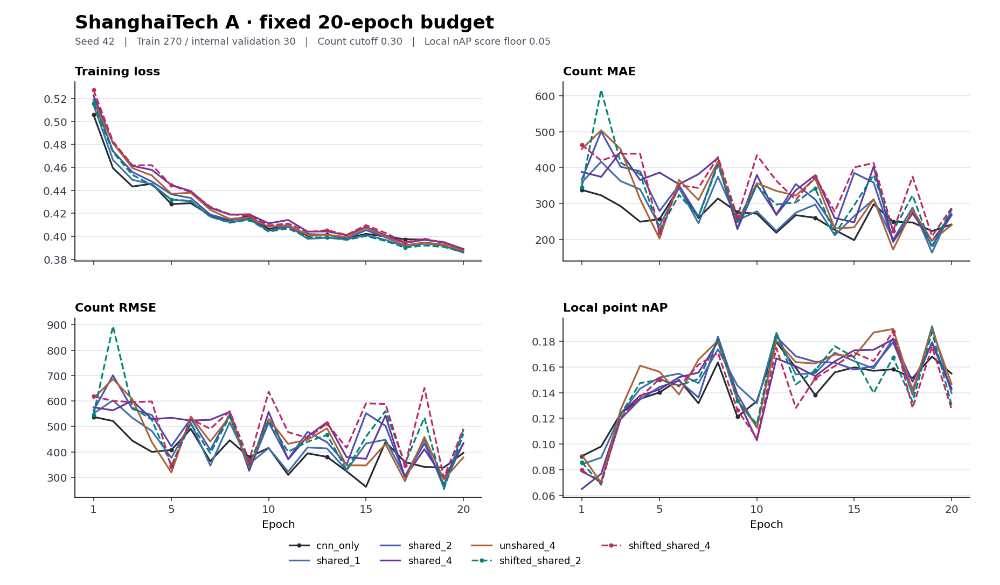

# LC-002R status

LC-002R follows the request-changes review on LC-002 PR #4. This stacked change preserves the original two-epoch experiments and fixed-window controls.

| Task | Evidence |
|---|---|
| A · Close points and seams | All in-frame tile candidates above the score floor enter AP. Counting uses source ownership. Regression cases cover two true 1 px neighbors, an exact overlap duplicate, and neighbors on opposite sides of a seam. |
| B · Local nAP | Eight fixtures match an independent dense oracle at every δ. The pinned P2PNet release supplies no runnable nAP evaluator. [Metric parity](metric_parity.json) |
| C · Recurrent window mixing | Alternating shifted partitions reuse one block. Direct token perturbations show cross-window influence and excluded opposite-edge influence. [Ablation](cross_window_ablation.md) |
| D · Budget and thresholds | Seven variants completed 20 epochs apiece at seed 42, with 19 internal-validation score cutoffs per best checkpoint. [Sweep](threshold_sweep.csv) |
| E · Strength of evidence | All runs use ShanghaiTech A train 270 and internal val 30. The stage and late-window checks below govern interpretation. |
| F · Verification | 55 WSL CPU tests passed. RTX 3090 timings and checkpoint hashes are recorded. [Tests](test_results.md) · [History and provenance](training_history.json) |
| G · Dataset scope | Official test is unused for threshold selection. NWPU original images remain incomplete and official F1 is `not_ready`. |

## Seed 42 results

The fixed 0.30 cutoff selects the checkpoint by minimum internal-validation MAE. The swept cutoff is chosen on the same internal validation split. Local nAP keeps a score floor of 0.05 throughout.

| Variant | Best epoch | Fixed MAE ↓ | Fixed RMSE ↓ | Local nAP ↑ | Val-selected cutoff | MAE at selected cutoff |
|---|---:|---:|---:|---:|---:|---:|
| cnn_only | 15 | 197.47 | 262.92 | 0.1597 | 0.30 | 197.47 |
| shared_1 | 19 | 162.63 | 259.50 | 0.1917 | 0.30 | 162.63 |
| shared_2 | 19 | 181.90 | 272.29 | 0.1793 | 0.30 | 181.90 |
| shared_4 | 17 | 192.50 | 300.54 | 0.1816 | 0.30 | 192.50 |
| unshared_4 | 17 | 171.23 | 284.80 | 0.1896 | 0.30 | 171.23 |
| shifted_shared_2 | 19 | 176.27 | 253.92 | 0.1873 | 0.30 | 176.27 |
| shifted_shared_4 | 19 | 208.73 | 298.68 | 0.1757 | 0.30 | 208.73 |

## Late-window check and seed decision

The prospective rule requires a ≤3% absolute change from mean loss in epochs 11–15 to epochs 16–20, and a ≤10% population coefficient of variation for internal-val MAE in epochs 16–20. All sampled last-step gradient norms must be finite. Additional seeds are triggered only if both CNN and the lowest fixed-cutoff MAE shared variant pass this check.

| Variant | Late loss change | Late MAE CV | Median sampled gradient L2, E1–5 → E16–20 | Pass |
|---|---:|---:|---:|:---:|
| cnn_only | -1.69% | 9.86% | 0.588 → 0.407 | yes |
| shared_1 | -2.24% | 23.05% | 0.748 → 0.657 | no |
| shared_2 | -2.45% | 24.94% | 1.367 → 0.497 | no |
| shared_4 | -2.76% | 28.66% | 1.582 → 0.451 | no |
| unshared_4 | -2.62% | 21.78% | 1.023 → 0.432 | no |
| shifted_shared_2 | -2.35% | 25.82% | 1.350 → 0.525 | no |
| shifted_shared_4 | -2.59% | 26.82% | 1.317 → 0.733 | no |

The fixed-cutoff rule selected `shared_1` for the shared side. Its 23.05% late MAE CV exceeded the 10% limit, so seeds 123/2026 remain `not_run`. With constant AdamW learning rate 0.0002, all seven late training-loss means fell by 1.69–2.76% and all sampled gradient norms remained finite. The sampled gradient median fell in every variant. Late validation MAE CV exceeded 21% in six of the seven runs. The fluctuations are primarily visible in validation under the fixed score cutoff. Last-step samples describe gradient scale and leave the cause of the validation variation unresolved.

Profiles are `smoke_only`. The completed fixed-budget runs are `pilot` unless the repeat-seed late-window check supports `converged_experiment`. All outcomes use internal validation and local nAP. Comparative claims beyond these conditions require repeat evidence.

The verified local NWPU shard contains 1,000 of 5,109 originals. SHA-256 `f27e4371323f0251ef3828df00a6603abbfaf1ccb42be285fa94e5bf3ec05345` matches the author release's `images_part1.zip`. The rest of the release is absent from the checked roots. Full NWPU audit and official F1 remain pending. [Author release](https://huggingface.co/datasets/Junyu3/NWPU-Crowd/blob/main/images_part1.zip)

[Experiment matrix](experiment_matrix.csv) · [Validation sweep](threshold_sweep.csv) · [Next steps](next_steps.md)
