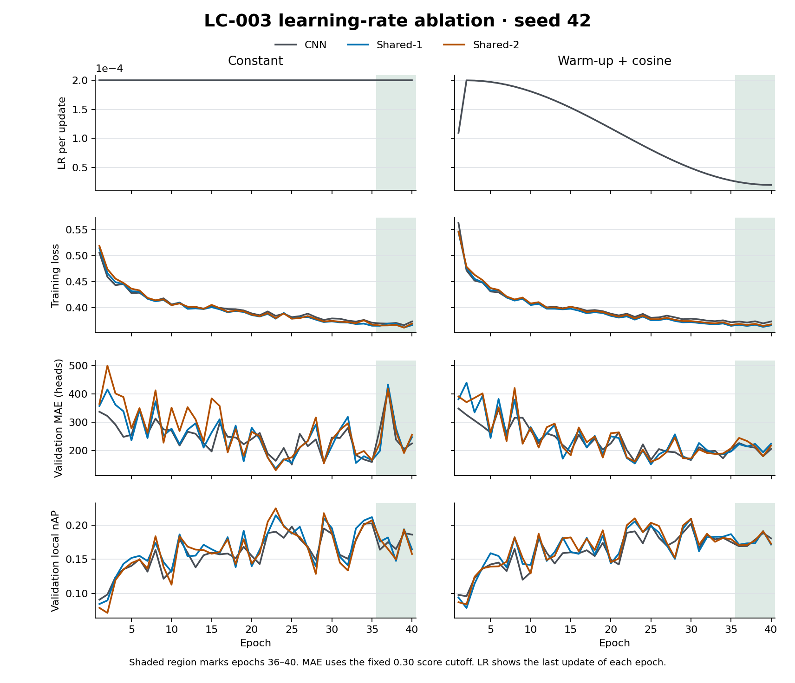

# LC-003 schedule and two-call comparisons

All pilots used ShanghaiTech Part A train270/internal-val30, one RTX 3090, batch two, BF16, native-scale random crops of 512 px and 40 epochs. Both schedules use the same seed, randomized crop coordinates and shuffle order for each epoch, local pretrained backbone, fresh point head, AdamW weight decay 0.01 and target policy. The primary endpoint is mean internal-validation MAE in epochs 36–40 at a fixed score >0.30. Checkpoint selection uses minimum MAE at the same cutoff, with the first occurrence retained on ties.

## Fixed schedule and stability rules

Each seed has 135 batches per epoch and a 5,400-update horizon. Constant uses LR 0.0002 throughout. In the cosine arm, one-indexed updates 1–270 linearly increase LR from 0.00002 to 0.0002. Updates 271–5,400 trace cosine decay from 0.0002 to 0.00002. Warm-up lasts 5% of the budget. The clock advances only when AdamW updates. BF16 produced no AMP skips. An FP16 skip repeats the same LR on the next attempted update. The checkpoint stores model, optimizer, AMP, scheduler and update position. A stopped warm-up run resumes with its original horizon.

The stability gate requires a population MAE CV ≤10% in epochs 36–40, an absolute relative change ≤3% from mean training loss in epochs 31–35 to mean loss in epochs 36–40, and finite monitored losses and gradient norms. Warm-up cosine is selected for all matched controls only if both CNN and Shared-2 pass its gate and each has strictly lower late mean MAE and CV than its own constant arm. All other outcomes retain constant. This policy was fixed in the training code before the first run. Configurations that omit the schedule retain constant LR.

## Seed-42 schedule ablation

| Variant | Schedule | Last-five MAE / RMSE / local nAP | MAE CV | Loss change | Gate | Best epoch and MAE / RMSE / local nAP | Final MAE / RMSE / local nAP |
|---|---|---|---:|---:|:---:|---|---|
| cnn_only | constant | 273.43 / 419.70 / 0.1757 | 27.72% | -1.33% | fail | E25 · 151.00 / 231.28 / 0.1979 | 225.80 / 326.01 / 0.1861 |
| cnn_only | warmup_cosine | 207.94 / 310.09 / 0.1772 | 7.43% | -0.65% | pass | E23 · 161.67 / 239.82 / 0.1909 | 206.30 / 312.71 / 0.1805 |
| shared_1 | constant | 271.14 / 437.87 / 0.1727 | 32.21% | -0.78% | fail | E23 · 137.07 / 194.26 / 0.2145 | 248.17 / 373.69 / 0.1644 |
| shared_1 | warmup_cosine | 216.27 / 338.49 / 0.1761 | 5.28% | -0.76% | pass | E25 · 151.93 / 221.47 / 0.1986 | 224.67 / 356.50 / 0.1714 |
| shared_2 | constant | 272.43 / 432.21 / 0.1690 | 28.49% | -1.56% | fail | E23 · 131.00 / 211.21 / 0.2246 | 256.43 / 392.54 / 0.1575 |
| shared_2 | warmup_cosine | 218.77 / 342.18 / 0.1765 | 9.95% | -0.82% | pass | E25 · 160.70 / 249.90 / 0.2034 | 218.03 / 342.09 / 0.1727 |

**Unified schedule for the matched controls: `warmup_cosine`.**
Warm-up cosine changed cnn_only mean MAE by -65.49 heads and CV by -20.29 percentage points. Its loss change was -0.65% and the full gate passed.
Warm-up cosine changed shared_2 mean MAE by -53.65 heads and CV by -18.54 percentage points. Its loss change was -0.82% and the full gate passed.

## Matched two-call comparisons

Every two-call configuration uses width 192, six heads, window size eight, the common CNN and point head, and the same loss, input and update budget. The regular pair uses two fixed partitions. The shifted pair uses shifts 0 and 4 with masked padding and no edge wrapping. In each pair the first block receives the same seed-specific initialization. The independent control draws its second block from the subsequent RNG state with the same initialization scheme. In the shared model both calls use one parameter object and both contribute gradients.

| Variant | Last-five MAE / RMSE / local nAP | MAE CV | Loss change | Gate | Best epoch and metrics | Final metrics |
|---|---|---:|---:|:---:|---|---|
| cnn_only | 207.94 / 310.09 / 0.1772 | 7.43% | -0.65% | pass | E23 · 161.67 / 239.82 / 0.1909 | 206.30 / 312.71 / 0.1805 |
| shared_1 | 216.27 / 338.49 / 0.1761 | 5.28% | -0.76% | pass | E25 · 151.93 / 221.47 / 0.1986 | 224.67 / 356.50 / 0.1714 |
| shared_2 | 218.77 / 342.18 / 0.1765 | 9.95% | -0.82% | pass | E25 · 160.70 / 249.90 / 0.2034 | 218.03 / 342.09 / 0.1727 |
| unshared_2 | 213.12 / 331.55 / 0.1841 | 6.46% | -0.85% | pass | E19 · 140.80 / 204.42 / 0.1969 | 222.57 / 342.72 / 0.1750 |
| shifted_shared_2 | 230.29 / 355.76 / 0.1711 | 6.39% | -0.83% | pass | E23 · 160.70 / 237.80 / 0.2071 | 221.83 / 343.14 / 0.1666 |
| shifted_unshared_2 | 209.14 / 323.64 / 0.1817 | 10.19% | -0.87% | fail | E19 · 128.93 / 184.85 / 0.1980 | 195.10 / 300.54 / 0.1780 |

Adding a second call to the shared fixed-window block changed late mean MAE by +2.51 heads relative to Shared-1 at seed 42. Both have one learned block and the same parameter count. Shared-1 performs one attention call and Shared-2 spends the compute of two.
This comparison provides no evidence that repeating the shared block improves the primary endpoint.
`shared_2` minus its matched `unshared_2` control changed late mean MAE by +5.65 heads.
`shifted_shared_2` minus its matched `shifted_unshared_2` control changed late mean MAE by +21.15 heads.

Both direct pairs match approximate forward FLOPs and differ in learned parameter count. When the shared arm has higher MAE, the result is a parameter–accuracy trade-off. Fixed and shifted pairs have separate geometry, timing and FLOP estimates.

## RTX 3090 resource profiles

Training step uses resident synthetic batch-two 512 px tensors with BF16, one warm-up step and nine synchronized timings. Inference profiles use one native-scale tile and the same real validation image, including tiled preprocessing and aggregation for full-image timing. Times are medians. Peak memory values report allocated/reserved MiB during the training measurement. FLOPs count two operations per MAC in convolution, linear and attention matrix multiplication.

| Variant | Parameters | GFLOP / 512 px tile | Train step ms | Tile forward ms | Full-image ms | Peak MiB |
|---|---:|---:|---:|---:|---:|---:|
| shared_2 | 1,596,614 | 32.745 | 16.15 | 4.21 | 59.18 | 496.0 / 666.0 |
| unshared_2 | 2,041,478 | 32.745 | 18.82 | 4.32 | 60.05 | 502.0 / 674.0 |
| shifted_shared_2 | 1,596,614 | 33.119 | 13.75 | 3.55 | 51.51 | 502.9 / 550.0 |
| shifted_unshared_2 | 2,041,478 | 33.119 | 14.12 | 3.78 | 55.46 | 508.9 / 560.0 |

Weight sharing reduces the parameter count by 444,864 (21.79%) in each pair. The common full-image timing input is 1021 × 611 pixels.

## Metric and diagnostic scope

Per-epoch records include count totals, local nAP, total/classification/offset loss, valid-slot counts and overflow. A represented training head occupies one positive slot. Valid grid cells provide two slots each, with padded cells excluded. Heads beyond cell capacity count toward overflow. Unscaled gradient L2 is measured over all model gradients before each step. The report stores mean, population SD, minimum and maximum for all 135 steps in every epoch. The raw histories retain every applied LR. The archived summaries store each epoch's first, last, minimum and maximum applied rate and checksums for the complete trajectories.

The 19-point 0.05–0.95 sweep re-evaluates the best checkpoint on internal validation for score diagnostics. Training and selection use the frozen 0.30 cutoff. Local nAP uses the 0.05 candidate floor and ranks predictions across validation images using spacing-relative matching.

| Variant | Matched-schedule best checkpoint MAE at 0.25 | At 0.30 | At 0.35 |
|---|---:|---:|---:|
| cnn_only | 421.07 | 161.67 | 349.90 |
| shared_1 | 628.43 | 151.93 | 326.63 |
| shared_2 | 530.10 | 160.70 | 351.10 |
| unshared_2 | 613.87 | 140.80 | 333.90 |
| shifted_shared_2 | 444.40 | 160.70 | 348.53 |
| shifted_unshared_2 | 572.17 | 128.93 | 348.50 |

## Additional seeds

The gate selected `shared_2` and its independent control. Seeds 123 and 2026 ran for all four selected variants. Eligible shared variants were ordered by lowest seed-42 late MAE, then higher late mean local nAP, then regular before shifted.

Mean and sample SD below use each seed's fixed-cutoff, last-five mean MAE. The three seeds support a descriptive comparison.

| Variant | Seed 42 | Seed 123 | Seed 2026 | Mean ± sample SD |
|---|---:|---:|---:|---:|
| cnn_only | 207.94 | 216.35 | 237.36 | 220.55 ± 15.15 |
| shared_1 | 216.27 | 215.33 | 233.19 | 221.60 ± 10.05 |
| shared_2 | 218.77 | 230.53 | 253.10 | 234.14 ± 17.44 |
| unshared_2 | 213.12 | 230.48 | 221.10 | 221.57 ± 8.69 |

The paired mean MAE difference for `shared_2` minus `unshared_2` was +12.57 heads (sample SD 17.06), with lower MAE for `shared_2` in 0 of 3 seeds.
The paired mean MAE difference for `shared_2` minus `shared_1` was +12.54 heads (sample SD 9.00), with lower MAE for `shared_2` in 0 of 3 seeds.
The paired mean MAE difference for `shared_2` minus `cnn_only` was +13.58 heads (sample SD 2.51), with lower MAE for `shared_2` in 0 of 3 seeds.

Repeat runs outside the stability gate were `cnn_only` seed 2026 (CV 11.64%, loss change -0.46%), `shared_1` seed 2026 (CV 10.63%, loss change -0.61%).

[Experiment matrix](experiment_matrix.csv) · [Raw-artifact provenance and epochs](training_history.json) · [Paired-seed results](paired_seed_results.csv)
